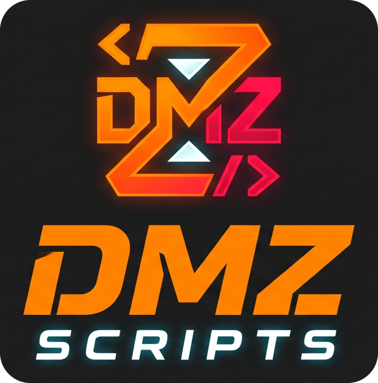
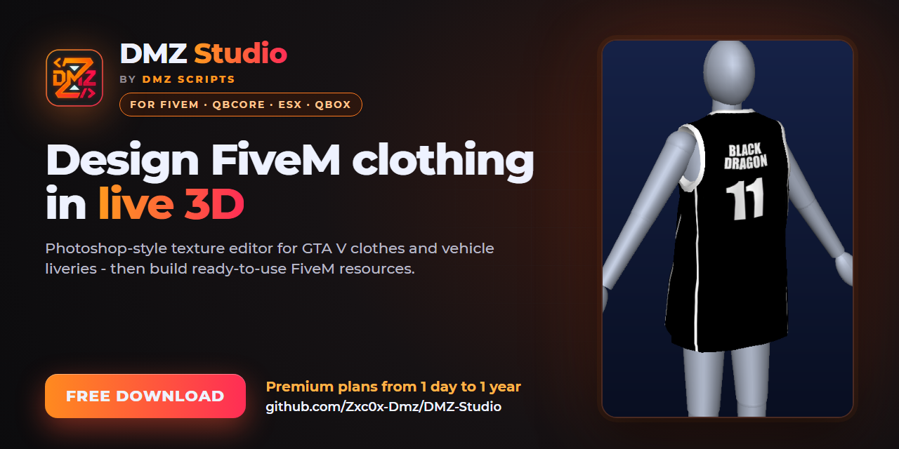
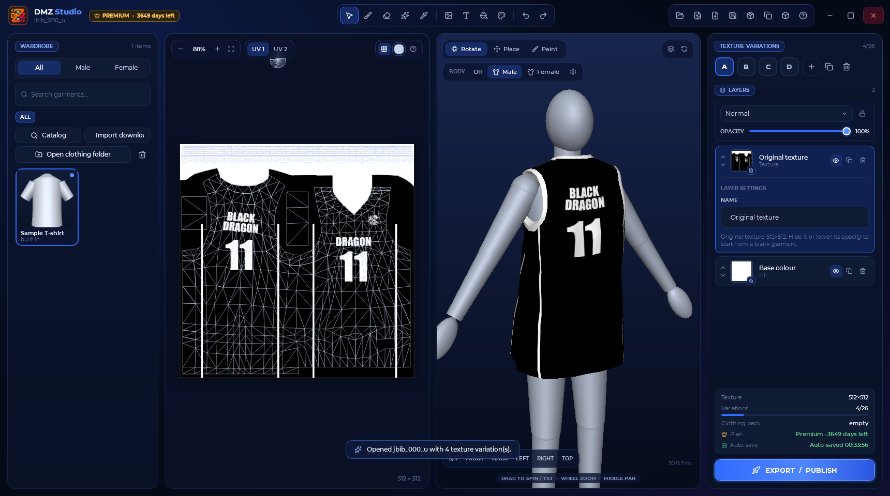
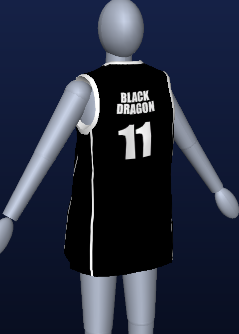
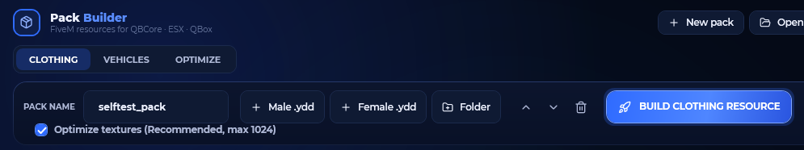

# DMZ Studio

by <b>DMZ Scripts</b>

**Design FiveM clothing and vehicle liveries with a live 3D preview - then build ready-to-use FiveM resources.**

**[Features](#features)** · **[Screenshots](#screenshots)** · **[Quick start](#quick-start)** · **[Free vs Premium](#free-and-premium)** · **[Get Premium](#get-premium)** · **[FAQ](#faq)**

 

## Download

**[Download DMZ-Studio.zip](https://github.com/Zxc0x-Dmz/DMZ-Studio/releases/latest/download/DMZ-Studio.zip)** - Windows 10/11 64-bit, version **1.2.6**.
No installer and nothing else to install. See [what's new](https://github.com/Zxc0x-Dmz/DMZ-Studio/releases).

## Features

<table>
<tr>
<td width="50%" valign="top">

### 🎨 Live 2D + 3D editing
Move a logo on the texture or grab it right on the 3D body - both update together. Click a part (like the sleeve) to see
exactly where it sits on the texture.

</td>
<td width="50%" valign="top">

### 🧍 Real GTA V body
Preview on the real freemode man and woman, read from your own GTA V install (Steam, Epic or Rockstar).

</td>
</tr>
<tr>
<td valign="top">

### 🖌️ Photoshop-style tools
Free transform with corner and side handles, smart guides with distances, a straight / tilted angle check, layers with
thumbnails, blend modes, lock, opacity, copy and paste.

</td>
<td valign="top">

### 🔤 Text, patterns and decals
Double-click to type - every Windows font plus your own `.ttf` / `.otf`. Base patterns: camo, carbon fibre, marble,
mosaic, hexagon, halftone, stripes and more - plus 8 carbon styles for cars (twill, herringbone, forged, spread tow,
honeycomb, kevlar hybrid, glossy). Drag PNG decals straight onto the body.

</td>
</tr>
<tr>
<td valign="top">

### 👕 Male + female in one click
Put the same design on the other gender's version of the garment. **Remove patch** erases logos printed on the original
texture.

</td>
<td valign="top">

### 📦 Pack Builder
Turn your garments into a ready-to-use FiveM clothing resource (`.ymt` / `.meta`) or vehicle resource, plus a texture
optimizer that keeps your server light. Over 128 items in a slot? It splits the pack for you. Edited something already
in your pack? **Save back to server** writes it straight into its own files - no rebuild, originals backed up.

</td>
</tr>
<tr>
<td colspan="2" valign="top">

### 🪧 MLO & Banners - no OpenIV
Open any MLO (mechanic shop, club, police station...) and see every sign, poster and logo. Drop your own picture on it
and it's saved in the MLO - size and quality kept, original backed up. Or make a sign show a **picture, GIF or video
from a web link** that admins change in game with `/banner`.

</td>
</tr>
<tr>
<td colspan="2" valign="top">

### 📸 Photo Studio - shop pictures without the game
A picture of **every garment, car or MLO object** in a folder, straight from the files - no screenshots in game.
Clothes are worn by the GTA V body (hair and hats on the head), cars get the paint colour you pick and are named by
spawn name for dealerships. See-through background and tiny **WebP** files (a few KB each), named by file or by
in-game number (like uz_AutoShot).

</td>
</tr>
<tr>
<td valign="top">

### 🧵 Works with what you have
grzyClothTool projects, the grzy.tools catalog, texture variations A-Z, folders of downloaded clothing - just drop them
on the window.

</td>
<td valign="top">

### ⚡ Fast on any PC
No graphics card needed - smooth even on million-triangle jewellery. Auto-save survives crashes and power cuts.

</td>
</tr>
</table>

## Screenshots

<table>
<tr>
<td width="36%"></td>
<td valign="middle">

**Live 3D preview** - spin, zoom and check every angle while you design. Switch between male and female, or show the
real GTA V body.

 

**Pack Builder** - add male / female models and their textures, press **Build** and drop the folder into your server.

</td>
</tr>
</table>

## Quick start

1. **[Download DMZ-Studio.zip](https://github.com/Zxc0x-Dmz/DMZ-Studio/releases/latest/download/DMZ-Studio.zip)** and extract it.
2. Open the `DMZ-Studio` folder and run **`DMZ-Studio.exe`**.
   If Windows shows *"Windows protected your PC"*, click **More info → Run anyway**.
3. Open a garment (`.ydd`) or drop a clothing folder on the window, design it, then **Export / Publish**.

## Free and Premium

| | Free | Premium |
|---|:---:|:---:|
| Open, design and preview everything | ✅ | ✅ |
| PNG export, save designs, auto-save | ✅ | ✅ |
| Pack Builder | up to 10 garments | **unlimited** |
| Export game textures (`.ytd` / `.dds`), all variations | - | ✅ |
| Publish designs into your clothing pack | - | ✅ |
| Texture optimizer | analyze | ✅ |
| Remove patch | - | ✅ |
| Same design for the other gender | - | ✅ |
| MLO & Banners: browse signs and save them as PNG | ✅ | ✅ |
| MLO & Banners: replace pictures, online banners | - | ✅ |
| Photo Studio: pictures of every garment, car, MLO object | - | ✅ |
| Save back to server (straight into your pack's files) | - | ✅ |

Premium is available for **1 day, 1 week, 1 month, 3 months or 1 year**. A license works on one PC.

## Get Premium

1. Open DMZ Studio and click the **FREE** badge at the top.
2. Click **Copy** next to your **Machine ID**.
3. Send your Machine ID and the plan you want to **DMZ** - fill in the
   **[Premium request form](https://github.com/Zxc0x-Dmz/DMZ-Studio/issues/new?template=premium.yml)** or message DMZ on Discord.
4. Paste the license key you get back and press **ACTIVATE**.

When a license ends, the Premium tools lock again - your designs are never lost. Renew the same way.

## System requirements

| | |
|---|---|
| **OS** | Windows 10 or 11, 64-bit |
| **Graphics card** | Not needed |
| **GTA V** | Optional - only for the real body preview (your own copy) |
| **Disk** | About 200 MB |

## FAQ

<b>Windows says "Windows protected your PC"</b>

That's Windows SmartScreen showing a new app it hasn't seen many times yet. Click **More info → Run anyway**.

<b>Do I need GTA V?</b>

No. You can open and design any `.ydd` garment without it. With GTA V installed, the **Select game** screen finds it and
shows your design on the real freemode body, read from your own game files.

<b>Some clothing won't open</b>

Models must be normal (unencrypted) GTA V files. Escrowed / encrypted assets can't be opened by any editor.

<b>I got a new PC (or reinstalled Windows)</b>

A license is tied to one PC. Send your new Machine ID to DMZ and you'll get a key for the new PC.

<b>What happens when my Premium ends?</b>

The Premium tools lock again, but your designs, saves and packs stay. Renew any time and carry on.

<b>I found a bug</b>

Please **[report it here](https://github.com/Zxc0x-Dmz/DMZ-Studio/issues/new?template=bug_report.yml)** - say what you
clicked and which garment you were working on.

## Media kit

Sharing DMZ Studio? Use the logo and posters:
[logo](assets/logo.png) · [app icon](assets/icon.png) · [banner 1280×640](assets/banner.png) ·
[feed post 1080×1350](assets/posters/dmz-studio-feed-1080x1350.png) ·
[story 1080×1920](assets/posters/dmz-studio-story-1080x1920.png) ·
[wide 1920×1080](assets/posters/dmz-studio-wide-1920x1080.png) ·
[all features](assets/posters/dmz-studio-features-1080x1350.png) ·
[Photo Studio](assets/posters/dmz-studio-photo-1080x1350.png) ·
[MLO & Banners](assets/posters/dmz-studio-mlo-1080x1350.png)

---

DMZ Studio is not affiliated with or endorsed by Rockstar Games or Cfx.re. GTA V and its assets belong to Rockstar
Games; DMZ Studio reads files from a copy you own and includes nothing from GTA V. Uses CodeWalker (MIT), SkiaSharp (MIT),
BCnEncoder.Net (MIT), Montserrat (SIL OFL 1.1) and Lucide icons (ISC). © DMZ Scripts. All rights reserved.
